# 🥷 Shadow Fight: The Shadow Clone

### A 2D silhouette fighting game built from scratch with **C++** and **OpenGL (freeglut)**


<br>

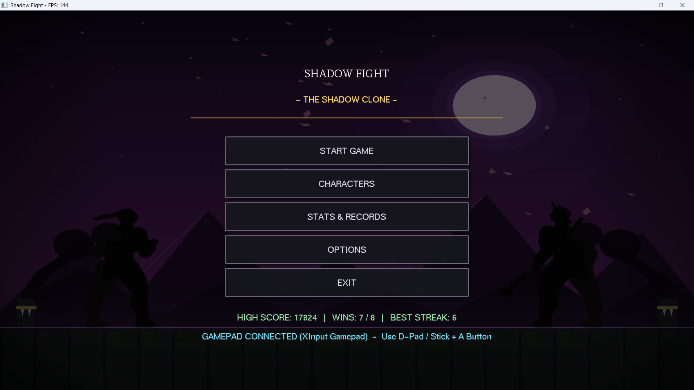

</div>

---

## 📖 About The Project

**Shadow Fight: The Shadow Clone** is a 2D fighting game inspired by the silhouette art style of *Shadow Fight*. Pick one of **five fighters**, each with their own weapon, combos and signature critical attack, and fight an AI opponent in a best-of-three match across moody, animated Japanese-style arenas.

The whole game, including the fighters, the backgrounds, the hit sparks and the UI, is drawn using only **OpenGL primitives**. No sprites or textures are used.

This project was built to learn and practice:

- Real-time game loop design and delta-time physics
- Object-oriented game architecture in C++
- Frame-data based combat (startup / active / recovery)
- Simple AI with difficulty levels
- Computer graphics with OpenGL

---

## 📸 Screenshots

### Fighting

<table>
  <tr>
    <td align="center" width="50%"><b>Round Start</b><br><br>
      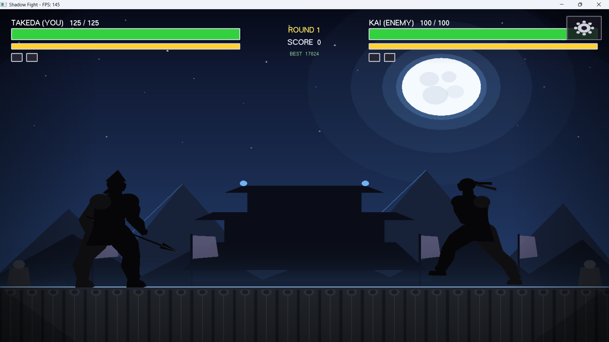
    </td>
    <td align="center" width="50%"><b>Combat</b><br><br>
      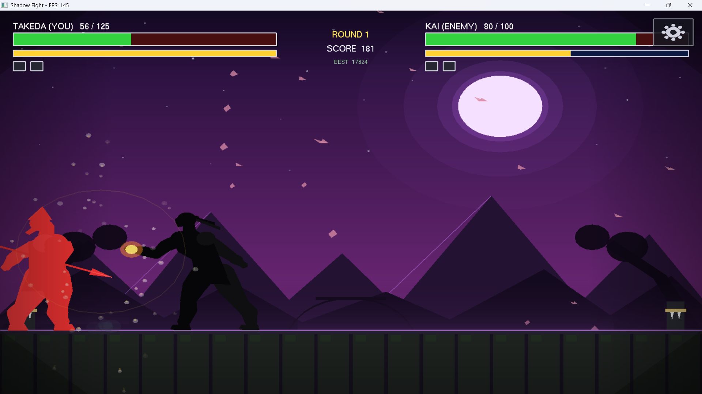
    </td>
  </tr>
  <tr>
    <td align="center" width="50%"><b>Special Attack</b><br><br>
      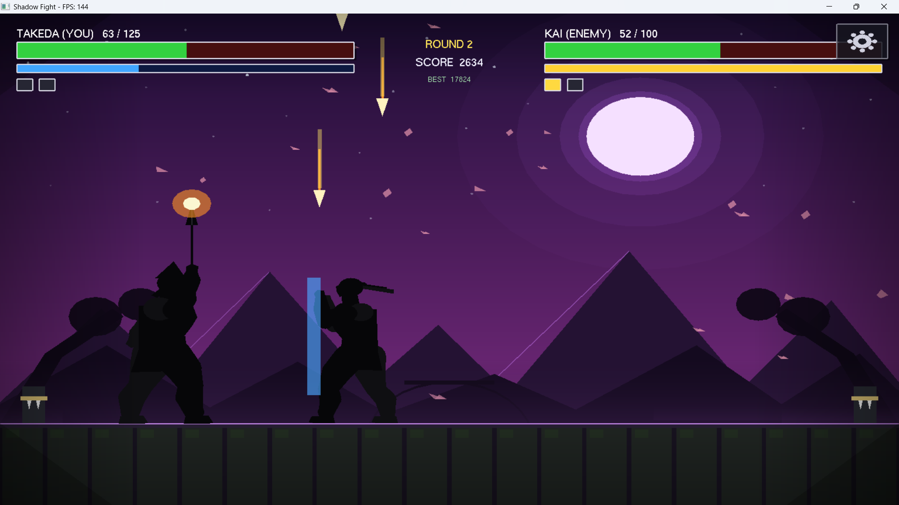
    </td>
    <td align="center" width="50%"><b>K.O. Screen</b><br><br>
      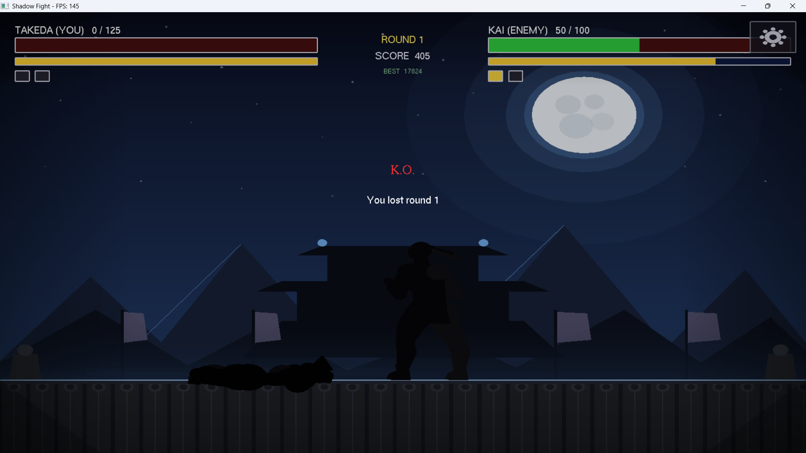
    </td>
  </tr>
</table>

### Characters

<table>
  <tr>
    <td align="center" width="50%"><b>Kai: Shadow Brawler</b><br><br>
      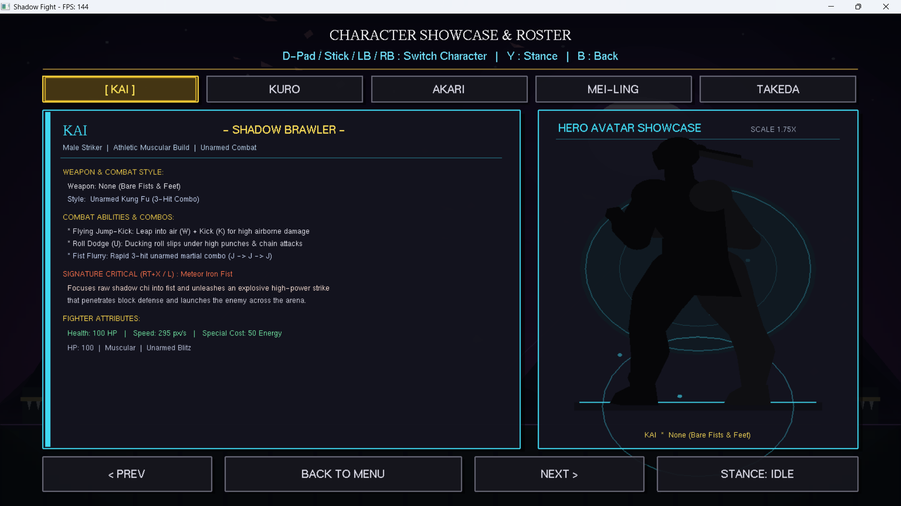
    </td>
    <td align="center" width="50%"><b>Akari: Shadow Archer</b><br><br>
      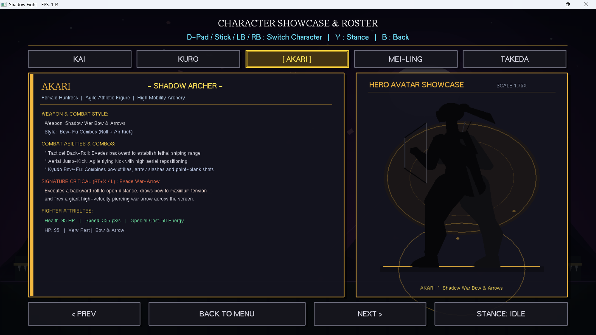
    </td>
  </tr>
</table>

### Menus & Settings

<table>
  <tr>
    <td align="center" width="50%"><b>Options</b><br><br>
      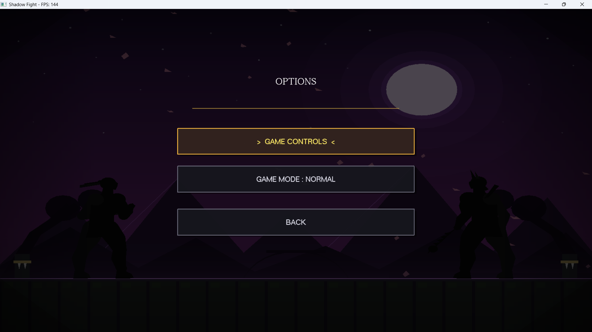
    </td>
    <td align="center" width="50%"><b>Game Mode Difficulty</b><br><br>
      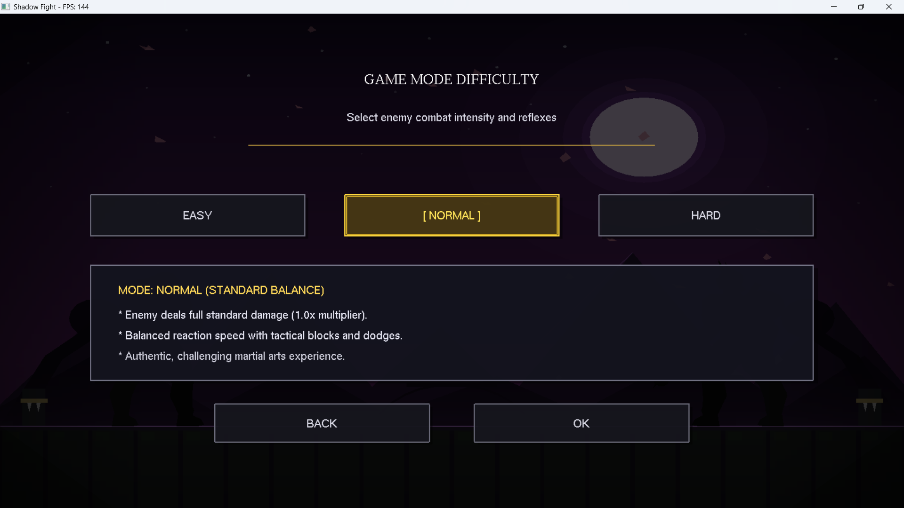
    </td>
  </tr>
  <tr>
    <td align="center" width="50%"><b>Keyboard Controls</b><br><br>
      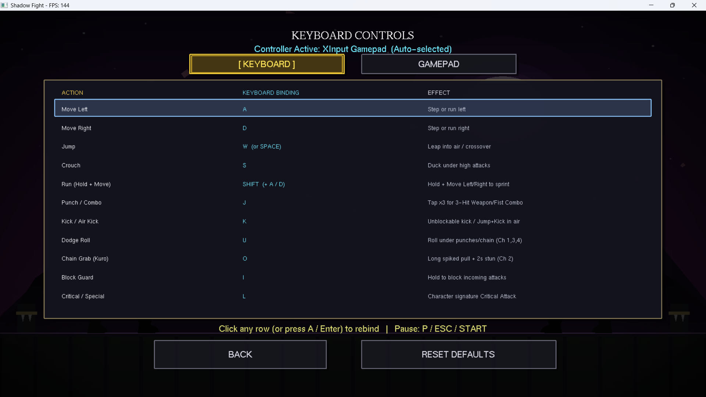
    </td>
    <td align="center" width="50%"><b>Gamepad Controls</b><br><br>
      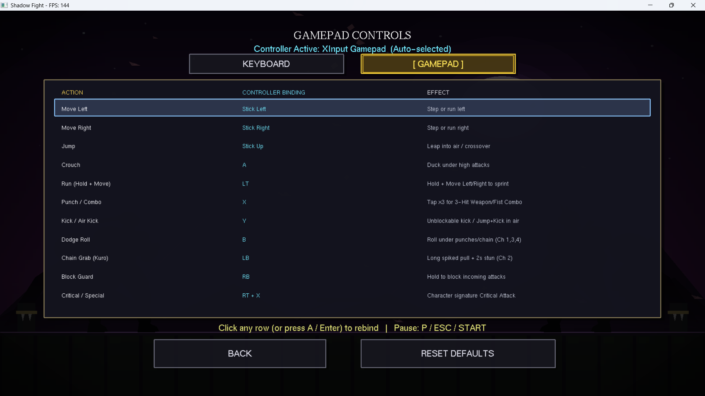
    </td>
  </tr>
  <tr>
    <td align="center" colspan="2"><b>Career Stats & High Scores</b><br><br>
      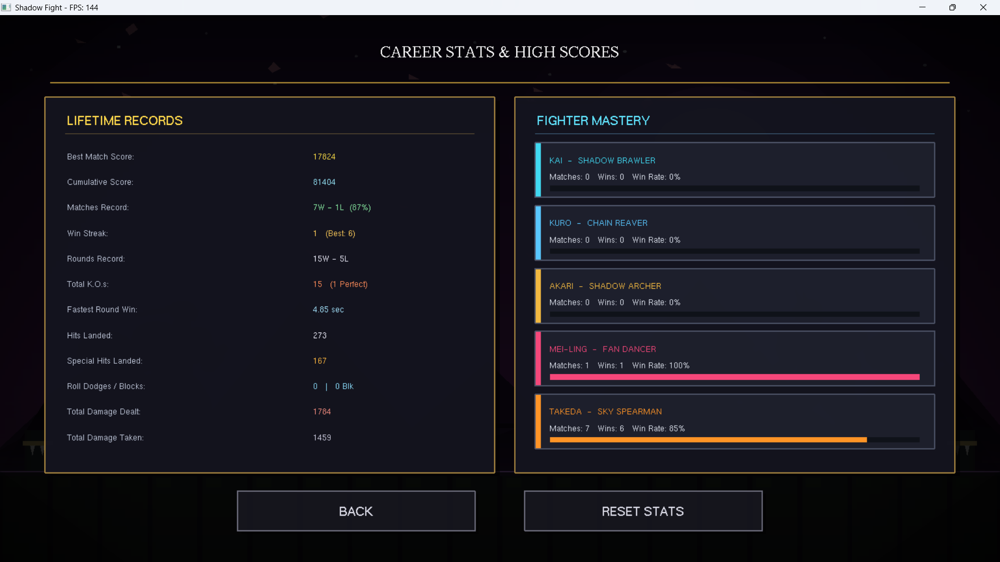
    </td>
  </tr>
</table>

---

## ✨ Features

### ⚔️ Combat System
- **Frame-data combat**: every attack has *startup → active → recovery* phases
- **Hitboxes & hurtboxes** with knockback and hit-stun
- **3-hit combos** on the punch button
- **Unblockable kicks**, plus **air kicks** after a jump
- **Dodge roll** to slip under punches and chain attacks
- **Blocking and crouching** to defend against attacks
- **Energy bar** that regenerates over time and is spent on each fighter's **signature Critical attack** (50 energy)
- **Run** by holding the sprint key while moving

### 🥷 Playable Fighters

| Fighter | Title | Weapon / Style | HP |
|:---:|---|---|:---:|
| **Kai** | Shadow Brawler | Bare fists and feet, 3-hit kung fu combo | 100 |
| **Kuro** | Chain Reaver | Chains, with a long spiked **Chain Grab** that pulls and stuns | n/a |
| **Akari** | Shadow Archer | Shadow war bow and arrows, back-roll and aerial kick | 95 |
| **Mei-Ling** | Fan Dancer | War fans | n/a |
| **Takeda** | Sky Spearman | Spear | 125 |

Each fighter has a signature Critical attack, for example Kai's **Meteor Iron Fist** (breaks through block) and Akari's **Evade War-Arrow** (back-roll into a giant piercing arrow). The **Characters** screen shows every fighter's abilities, stats and a live avatar with switchable stance.

### 🤖 Enemy AI
- AI states: `IDLE`, `APPROACH`, `RETREAT`, `DEFEND`, `JUMP`, `ATTACK`, `HIT`, `DEAD`
- Reacts to your attacks by blocking or dodging
- Keeps a randomised preferred distance from the player
- **3 difficulty modes** that change reaction time, aggression and damage:

| Mode | Enemy Behaviour | Enemy Damage |
|:---:|---|:---:|
| 🟢 **Easy** | Slow reactions, rarely blocks | ×0.65 |
| 🟡 **Normal** | Balanced blocks and dodges | ×1.00 |
| 🔴 **Hard** | Fast, aggressive, rarely hesitates | ×1.50 |

### 🎨 Visuals
- Hand-drawn **silhouette fighters** with unique weapons
- Multiple **lighting themes** (moonlit night, purple dusk and more) and **arenas** (temple, mountain peaks and more), picked per fight
- **Hit sparks**, dust puffs, shockwave rings, falling petals and **screen shake**
- Glowing special-attack effects and animated backgrounds

### 🕹️ Game Flow & Extras
- Full menu system: **Start Game, Characters, Stats & Records, Options, Exit**
- **Best of 3 rounds** with round-intro and K.O. screens
- In-fight **HUD**: health, energy, round wins, live score and best score
- Pause menu with in-fight settings (settings icon in the HUD)
- **Rebindable controls** for both keyboard and gamepad (click a row to rebind, or reset to defaults)
- **XInput gamepad support** with auto-detection and full menu navigation
- 🔊 **Sound effects**
- 🏆 **Career stats & high scores**: best match score, win/loss record, win streak, rounds record, K.O.s, fastest round win, hits landed, damage dealt and taken, plus per-fighter mastery and win rate
- Debug hitbox view for development

---

## 🎮 Controls

Every binding below can be changed from **Options → Game Controls**.

### ⌨️ Keyboard

| Key | Action | Notes |
|:---:|---|---|
| `A` / `D` | Move left / right | |
| `W` or `Space` | Jump | Leap into air / crossover |
| `S` | Crouch | Duck under high attacks |
| `Shift` + `A`/`D` | Run | Hold to sprint |
| `J` | Punch / Combo | Tap ×3 for a 3-hit combo |
| `K` | Kick / Air Kick | Unblockable, also works as a jump kick |
| `U` | Dodge Roll | Roll under punches and chain attacks |
| `O` | Chain Grab | Kuro only: long spiked pull and 2s stun |
| `I` | Block | Hold to guard |
| `L` | Critical / Special | Fighter's signature attack, costs 50 energy |
| `P` / `Esc` | Pause | Opens the in-fight menu |
| `R` | Restart | After a match ends |
| `H` | Toggle hitbox debug view | Developer tool |
| `T` | Restore health and energy | Developer / test tool |

### 🎮 Gamepad (XInput)

| Input | Action |
|:---:|---|
| Left Stick ← / → | Move left / right |
| Left Stick ↑ | Jump |
| `A` | Crouch |
| `LT` + Stick | Run |
| `X` | Punch / Combo |
| `Y` | Kick / Air Kick |
| `B` | Dodge Roll |
| `LB` | Chain Grab (Kuro) |
| `RB` | Block |
| `RT` + `X` | Critical / Special |
| `Start` | Pause |

---

## 🚀 Getting Started

### Prerequisites
- A C++ compiler (**MinGW / GCC** recommended)
- **Code::Blocks** IDE (the project file is included)
- **freeglut** and OpenGL libraries (`freeglut`, `opengl32`, `glu32`)

### Option 1: Just play (Windows)
1. Go to the **[Releases](../../releases)** page (or the `Shadow_Fight_Clone/bin/Debug/` folder)
2. Download and run `Shadow_Fight_Clone.exe`
3. Keep `freeglut.dll` in the same folder as the `.exe`

### Option 2: Build from source with Code::Blocks
```bash
# 1. Clone the repository
git clone https://github.com/ShanjidulNuhin/Shadow_Fight_Clone.git

# 2. Open the project file in Code::Blocks
Shadow_Fight_Clone/Shadow_Fight_Clone.cbp

# 3. Make sure freeglut is set up in your compiler settings, then
#    press Build and Run (F9)
```

### Option 3: Build from the command line (MinGW)
```bash
cd Shadow_Fight_Clone/Shadow_Fight_Clone
g++ *.cpp -o Shadow_Fight_Clone.exe -lfreeglut -lopengl32 -lglu32 -O2
```

> 💡 If the build fails with a missing `GL/glut.h` error, install freeglut and add its `include` and `lib` folders to your compiler search directories.

---

## 🗂️ Project Structure

```
Shadow_Fight_Clone/
├── main.cpp              # Entry point, GLUT setup and callbacks
├── Game.h / .cpp         # Game states, menus, rounds, main loop logic
├── Config.h              # World size, physics constants, round rules
│
├── Fighter.h / .cpp      # Base fighter: physics, states, drawing
├── Player.h / .cpp       # Player-controlled fighter
├── Enemy.h / .cpp        # AI-controlled opponent
├── AttackData.h          # Frame data for attacks
├── CombatSystem.h / .cpp # Hit detection and damage resolution
├── Collision.h / .cpp    # Rectangle collision helpers
├── Animation.h / .cpp    # Animation helpers
│
├── Renderer.h / .cpp     # Low-level OpenGL drawing helpers
├── Background.h / .cpp   # Arenas and lighting themes
├── Effects.h / .cpp      # Sparks, dust, shockwaves, screen shake
├── UI.h / .cpp           # HUD, menus, dialogs
├── InputManager.h / .cpp # Keyboard and gamepad state tracking
│
├── screenshots/          # Images used in this README
└── Shadow_Fight_Clone.cbp  # Code::Blocks project file
```

---

## 🧠 How It Works

```
 ┌─────────────┐   input    ┌──────────┐
 │ InputManager│──────────▶│  Player  │──┐
 └─────────────┘            └──────────┘  │      ┌──────────────┐
                                          ├────▶│ CombatSystem │──▶ damage, knockback
 ┌─────────────┐  watches   ┌──────────┐  │      └──────────────┘
 │   Player    │──────────▶│  Enemy   │──┘             │
 └─────────────┘            │   (AI)   │                ▼
                            └──────────┘        ┌──────────────┐
                                                │ Effects / UI │
                                                └──────────────┘
```

1. **Game loop**: GLUT's idle callback computes `deltaTime`, then `Game::update()` and `Game::draw()` run every frame.
2. **Fighter state machine**: `IDLE → WALK → JUMP/FALL → CROUCH → BLOCK → PUNCH/KICK/SPECIAL → HIT → DEAD`.
3. **Attack phases**: `STARTUP → ACTIVE → RECOVERY`. Only the *active* phase can hurt, so timing and spacing matter.
4. **Combat**: `CombatSystem` checks if an active hitbox overlaps the opponent's hurtbox, then applies damage, knockback and hit-stun, or blocks the hit.
5. **AI**: the enemy chooses between approaching, retreating, defending, jumping and attacking based on distance and the player's actions.

---

## 🛠️ Built With

| Technology | Purpose |
|---|---|
| **C++** | Core game logic (OOP) |
| **OpenGL** | All 2D rendering |
| **freeglut** | Window, input and main loop |
| **XInput** | Gamepad support |
| **Code::Blocks + MinGW** | IDE and compiler |

---

## 🗺️ Roadmap

- [x] Player vs AI combat
- [x] 3 difficulty modes
- [x] Multiple arenas and lighting themes
- [x] Menus, pause and best-of-3 rounds
- [x] 🔊 Sound effects
- [x] 🥋 Combo system
- [x] 🧙 5 playable characters with unique weapons
- [x] 🏆 High-score and stats tracking
- [x] 🎮 Gamepad support and rebindable controls
- [ ] 👥 Local 2-player mode

---

## 🤝 Contributing

Contributions, ideas and bug reports are welcome!

1. Fork the project
2. Create your branch: `git checkout -b feature/AmazingFeature`
3. Commit your changes: `git commit -m "Add AmazingFeature"`
4. Push to the branch: `git push origin feature/AmazingFeature`
5. Open a Pull Request

---

## 👨‍💻 Author

**Shanjidul Nuhin**
CSE Student, American International University-Bangladesh (AIUB)

[](https://github.com/ShanjidulNuhin)

---

## 🙏 Acknowledgements

- Inspired by the art style of the *Shadow Fight* series (this is a fan-made educational project, not affiliated with Nekki)
- [freeglut](https://freeglut.sourceforge.net/) for the windowing toolkit
- Built as a learning project at AIUB

---

<div align="center">

### ⭐ If you enjoyed the game, please give the repo a star!

</div>
